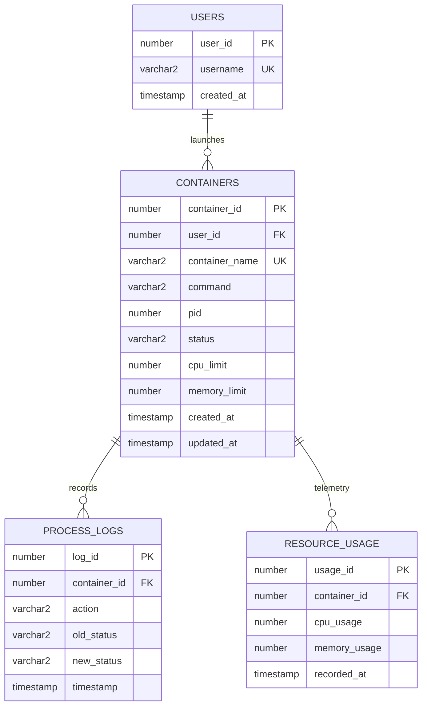

# ContainerOS (MiniDocker)

A lightweight, educational container-management system built for a college PBL (Project-Based Learning) submission. It demonstrates core **Operating Systems** and **Database Management Systems (DBMS)** concepts by managing real OS processes as "containers" while an Oracle / relational database tracks all metadata, state, and audit history.

> **Note on scope:** This is *not* a Docker replacement. There are no Linux namespaces or cgroups — a "container" here is a real OS process launched via `fork()`/`execvp()` and tracked end-to-end. The project's purpose is to demonstrate process lifecycle management and relational database concepts (transactions, ACID, PL/SQL, concurrency control), not to reimplement containerization.

---

## What it does

- Create,  stop, restart, and delete containers (OS processes).
- Track process state through a formal lifecycle: `CREATED → RUNNING → STOPPED / EXITED / FAILED`.
- Persist all container/process metadata, resource telemetry, and lifecycle audit logs in an Oracle relational database (with automatic offline SQLite engine for instant demo).
- Demonstrate transactional consistency (ACID) between DB state and actual OS state (automatic rollback and cleanup on failure).
- Demonstrate concurrency control via Oracle row-level locking (`SELECT ... FOR UPDATE`).

---

## Concepts Demonstrated

### Operating Systems
- **Process creation:** `fork()`, `execvp()`
- **Process synchronization:** `wait()` / `waitpid(..., WNOHANG)`
- **Signal handling:** `SIGTERM` (graceful stop) and `SIGKILL` (force kill)
- **Lifecycle state management:** Dynamic status tracking and exit-code detection
- **Resource limiting:** Kernel quotas via `setrlimit()` (`RLIMIT_CPU`, `RLIMIT_AS`)
- **Telemetry extraction:** Real-time resident memory (RSS) and CPU usage monitoring

### DBMS (Oracle / Relational SQL)
- **Relational modeling:** 3NF normalized schema with `users`, `containers`, `process_logs`, `resource_usage`
- **Integrity constraints:** Foreign keys with `ON DELETE CASCADE`, domain `CHECK` constraints, unique keys
- **Performance indexing:** B-Tree indexes on foreign keys and high-cardinality status/PID columns
- **ACID guarantees:** Atomic process creation; rollback and orphaned process cleanup on failures
- **PL/SQL stored procedures:** Encapsulated business transactions in `minidocker_pkg`
- **PL/SQL triggers:** Automated audit logging on state transitions into immutable ledger
- **Concurrency control:** Pessimistic row-level locking (`SELECT ... FOR UPDATE`) preventing lost updates

---

## Architecture

```
┌────────────────────────────────────────────────────────┐
│                   CLI Layer (Python)                   │
│                    cli/containeros.py                  │
│  [run | ps | inspect | stop | kill | restart | rm | logs] │
└───────────────┬────────────────────────┬───────────────┘
                │                        │
   Process      │                        │  ACID Transactions &
   Control /    │                        │  Audit Logging
   Telemetry    │                        │
                ▼                        ▼
┌───────────────────────────┐  ┌─────────────────────────┐
│     OS Runtime Layer      │  │     Database Layer      │
│            (C)            │  │     (Oracle / SQL)      │
│ runtime/process_manager.c │  │ db/schema.sql           │
├───────────────────────────┤  │ db/procedures.sql       │
│ • fork() & execvp()       │  │ db/triggers.sql         │
│ • waitpid(WNOHANG)        │  │ db/seed.sql             │
│ • kill(SIGTERM/SIGKILL)   │  │ db/concurrency_demo.sql │
│ • setrlimit(CPU, MEM)     │  ├─────────────────────────┤
│ • /tmp/minidocker_logs/   │  │ • minidocker_pkg        │
└───────────────────────────┘  │ • Automated Triggers    │
                               │ • Row-level Locking     │
                               └─────────────────────────┘
```

---

## Entity-Relationship (ER) Diagram



---

## Project Structure

```
MiniDoc-PBL/
├── db/
│   ├── schema.sql           # DDL: Relational tables, constraints, indexes
│   ├── procedures.sql       # PL/SQL: minidocker_pkg stored procedures (ACID)
│   ├── triggers.sql         # PL/SQL: Automated audit triggers
│   ├── seed.sql             # Comprehensive seed data for viva demo
│   └── concurrency_demo.sql # Two-session concurrency & row-locking viva script
├── runtime/                 # C: Low-level process supervisor & POSIX syscalls
│   ├── process_manager.c    # fork, setsid, waitpid, signals, setrlimit, meta files
│   ├── process_manager.h    # Header definitions & data structures
│   └── Makefile             # GCC compilation rules
├── cli/                     # Python CLI orchestration layer
│   └── containeros.py       # User CLI commands & dual-engine DB adapter
├── tests/                   # Automated regression test suite
│   └── test_lifecycle.py    # End-to-end lifecycle, signals, rollback & DBMS tests
├── docs/
│   └── report.md            # Comprehensive academic PBL report
├── .gitignore               # Git ignore rules (binaries, databases, caches)
└── README.md                # Project documentation
```

---

## Quick Start & Usage

### 1. Prerequisites
- **Compiler:** GCC or Clang (`gcc`, `make`)
- **Python:** Python 3.8+
- **Database (Optional):** Oracle Database 19c/21c (or python-oracledb). If Oracle credentials are not set, the CLI automatically boots an embedded relational SQLite engine for 100% offline portability.

### 2. Build the C Process Runtime
```bash
make -C runtime
```
*(The CLI will also auto-compile the runtime on first invocation if the binary is missing).*

### 3. CLI Command Reference

| Command | Description | Example |
| :--- | :--- | :--- |
| `run` | Launch a tracked background container workload | `python3 cli/containeros.py run "sleep 60" --name worker1 --cpu 10` |
| `ps` | List running containers (`-a` for all states) | `python3 cli/containeros.py ps -a` |
| `inspect` | Display metadata, PID, and live resource telemetry | `python3 cli/containeros.py inspect 1` |
| `stats` | Display real-time CPU % and Memory RSS consumption | `python3 cli/containeros.py stats [id]` |
| `stop` | Gracefully terminate container with `SIGTERM` (escalates to `SIGKILL`) | `python3 cli/containeros.py stop 1` |
| `kill` | Forcefully terminate container with `SIGKILL` | `python3 cli/containeros.py kill 1` |
| `restart` | Restart a workload with a fresh OS PID | `python3 cli/containeros.py restart 1` |
| `rm` | Remove container (cascading delete in DB & disk cleanup) | `python3 cli/containeros.py rm 1` |
| `logs` | View state transition audit trail and process output | `python3 cli/containeros.py logs 1 --output` |

### 4. Running the Automated Test Suite
To verify end-to-end lifecycle operations, exit-code capture, and DBMS ACID constraints:
```bash
python3 -m unittest discover tests
```

### 5. Running the Concurrency & Row Locking Demo
To demonstrate Oracle concurrency control and row-level locks during viva:
```bash
# Connect to SQL*Plus or SQL Developer and execute:
@db/concurrency_demo.sql
```
This tests two concurrent sessions attempting conflicting status transitions on the same container, proving that pessimistic locking prevents lost updates.

---

## Implementation Status

- [x] **Phase 1: Relational Schema & Constraints** (`db/schema.sql`)
- [x] **Phase 2: Automated Audit Triggers** (`db/triggers.sql`)
- [x] **Phase 3: PL/SQL Stored Procedures & ACID Control** (`db/procedures.sql`)
- [x] **Phase 4: C Process Manager with POSIX Syscalls** (`runtime/process_manager.c`)
- [x] **Phase 5: CLI Integration & Dual-Engine DB Adapter** (`cli/containeros.py`)
- [x] **Phase 6: Seed Data & Concurrency Demonstration** (`db/seed.sql`, `db/concurrency_demo.sql`)
- [x] **Phase 7: Academic Project Report** (`docs/report.md`)
