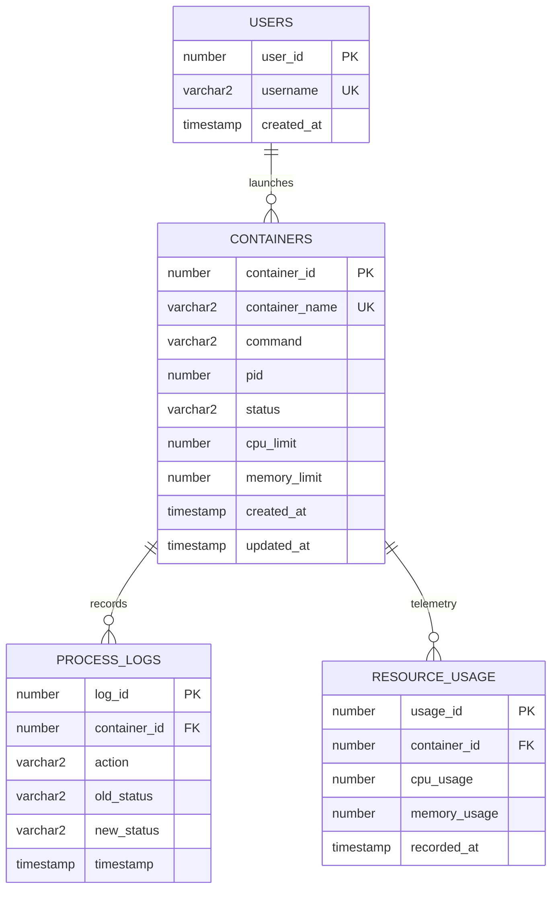

# MiniDocker (ContainerOS) - Project-Based Learning (PBL) Report

**Course Domain:** Operating Systems (OS) & Database Management Systems (DBMS)  
**Project Title:** MiniDocker (ContainerOS): Academic Container Lifecycle Management System  
**Target Environment:** Linux / POSIX (macOS compatible development)  
**Primary Technologies:** C (POSIX System Calls), Python (CLI & Orchestration), Oracle PL/SQL / Relational SQL  

---

## 1. Executive Summary & Abstract

**MiniDocker (ContainerOS)** is an educational, full-stack systems project created for an academic Project-Based Learning (PBL) curriculum. It demonstrates the intersection of low-level **Operating Systems** concepts and enterprise **Database Management Systems (DBMS)** principles.

Unlike modern production container engines (such as Docker or Podman) which rely on Linux kernel namespaces (`clone(CLONE_NEWPID, ...)`) and Control Groups (`cgroups`), MiniDocker treats native OS processes as containerized workloads. Each workload is instantiated via POSIX system calls (`fork()`, `execvp()`), governed by kernel resource constraints (`setrlimit()`), and controlled via asynchronous signal dispatch (`SIGTERM`, `SIGKILL`).

Simultaneously, MiniDocker couples the OS process lifecycle with an **Oracle Relational Database**. Every lifecycle transition (`CREATED`, `RUNNING`, `STOPPED`, `EXITED`, `FAILED`), resource telemetry metric (CPU percentage, Resident Set Size memory), and operational audit event is managed with strict ACID transaction guarantees. Database integrity is preserved through PL/SQL stored procedures (`minidocker_pkg`), automated triggers (`BEFORE/AFTER INSERT/UPDATE`), and pessimistic row-level locking (`SELECT ... FOR UPDATE`) to prevent race conditions during concurrent management operations.

---

## 2. Problem Statement & Academic Objectives

### 2.1 The Problem
In standard academic curricula, Operating Systems and Database Systems are taught as isolated disciplines:
- OS courses teach process lifecycles, scheduling, and system calls in isolation from persistence layers.
- DBMS courses explore relational modeling, normalization, and ACID transactions using synthetic banking or e-commerce datasets without interactions with kernel-level subsystems.

MiniDocker bridges this divide by answering:
1. *How can an application guarantee transactional consistency (ACID) between ephemeral OS process states and persistent database records?*
2. *What happens when a low-level system call (`fork()` or `exec()`) fails after a database record has been staged, and how does rollback prevent orphaned states?*
3. *How do database concurrency mechanisms (row locks, transaction isolation) resolve race conditions when multiple CLI clients manipulate shared OS processes?*

### 2.2 Key Learning Objectives
- **OS Concepts:** Process creation (`fork`, `execvp`), process synchronization (`waitpid`), signal handling (`SIGTERM`, `SIGKILL`), kernel resource quotas (`setrlimit`), and telemetry extraction.
- **DBMS Concepts:** 3NF relational modeling, foreign key cascades, domain check constraints, PL/SQL stored procedures with transaction boundaries (`COMMIT`/`ROLLBACK`), automated audit triggers, and row-level concurrency control (`FOR UPDATE`).

---

## 3. High-Level Architecture & Component Design

The system implements a decoupled, 3-tier modular architecture:

```
┌────────────────────────────────────────────────────────┐
│                   CLI Layer (Python)                   │
│             cli/containeros.py (Entrypoint)            │
│  [run | ps | inspect | stop | kill | restart | rm | logs] │
└───────────────┬────────────────────────┬───────────────┘
                │                        │
   Process      │                        │  ACID State Management &
   Control /    │                        │  Audit Logging
   Telemetry    │                        │
                ▼                        ▼
┌───────────────────────────┐  ┌─────────────────────────┐
│     OS Runtime Layer      │  │     Database Layer      │
│            (C)            │  │     (Oracle/SQL)        │
│ runtime/process_manager.c │  │ db/schema.sql           │
├───────────────────────────┤  │ db/procedures.sql       │
│ • fork() & execvp()       │  │ db/triggers.sql         │
│ • waitpid(WNOHANG)        │  │ db/seed.sql             │
│ • kill(SIGTERM/SIGKILL)   │  │ db/concurrency_demo.sql │
│ • setrlimit(CPU, MEM)     │  ├─────────────────────────┤
│ • /tmp/minidocker_logs/   │  │ • minidocker_pkg        │
└───────────────────────────┘  │ • Automated Triggers    │
                               │ • Row-level Locking     │
                               └─────────────────────────┘
```

### Component Breakdown
1. **User Interaction & Orchestration (`cli/containeros.py`):**
   - Implements a user-friendly command-line interface mimicking container tools (`run`, `ps`, `inspect`, `stop`, `kill`, `restart`, `rm`, `logs`).
   - Acts as the transaction coordinator, reconciling OS state with database state.
   - Includes automatic SQLite fallback for offline demonstrations and viva examinations.

2. **C Process Manager (`runtime/process_manager.c` & `runtime/process_manager.h`):**
   - Compiles to a standalone binary (`process_manager`) providing atomic CLI subcommands (`run`, `status`, `stop`, `kill`, `restart`, `metrics`).
   - Interacts directly with the POSIX kernel interface without third-party runtime dependencies.
   - Redirects stdout/stderr to `/tmp/minidocker_logs/proc_<PID>.log`.

3. **Relational Database Engine (`db/*.sql`):**
   - **Schema (`schema.sql`):** Normalized third normal form (3NF) tables with referential integrity and indexes.
   - **Stored Procedures (`procedures.sql`):** Encapsulated business logic within `minidocker_pkg` ensuring single-transaction state changes.
   - **Triggers (`triggers.sql`):** Non-bypassable audit logging in `process_logs`.
   - **Concurrency Testing (`concurrency_demo.sql`):** Reproducible scripts demonstrating lock contention and isolation.

---

## 4. Operating Systems Concepts Demonstrated

### 4.1 Process Creation via `fork()` and `execvp()`
Process spawning in `runtime/process_manager.c` separates process duplication from binary loading:
1. The parent process calls `fork()`.
2. The child process receives PID 0:
   - Applies resource quotas via `setrlimit()`.
   - Sets up file descriptors (redirecting `stdout` and `stderr` to a container log file).
   - Invokes `execvp("/bin/sh", ["sh", "-c", command, NULL])` to execute the user payload.
3. The parent process records the child's `pid` and returns control to the Python orchestrator.

### 4.2 Non-Blocking Process Synchronization via `waitpid(WNOHANG)`
To determine if a container has exited without freezing the CLI:
```c
int status;
pid_t res = waitpid(pid, &status, WNOHANG);
if (res == 0) {
    // Process is still running
} else if (res == pid) {
    // Process exited or terminated by signal
    if (WIFEXITED(status)) {
        int exit_code = WEXITSTATUS(status);
        // Transition to EXITED
    } else if (WIFSIGNALED(status)) {
        // Transition to FAILED / STOPPED
    }
}
```

### 4.3 Signal Dispatch & Lifecycle Management
- **Graceful Termination (`SIGTERM`):** Dispatched by `containeros stop <ID>`. Allows processes catching signals to flush buffers and cleanly exit. If the process does not terminate within a timeout, escalation to `SIGKILL` occurs.
- **Forceful Termination (`SIGKILL`):** Dispatched by `containeros kill <ID>`. Cannot be caught or ignored; forces immediate termination by the kernel scheduler.

### 4.4 Kernel Resource Limiting via `setrlimit()`
MiniDocker enforces quotas before invoking `execvp`:
- `RLIMIT_CPU`: Maximum CPU consumption time in seconds. If exceeded, the kernel dispatches `SIGXCPU` and terminates the process.
- `RLIMIT_AS` (or `RLIMIT_DATA`): Address space and memory bounds in bytes. If memory allocations (`malloc`/`brk`/`mmap`) exceed this limit, the call fails with `ENOMEM`.

```c
if (limits->cpu_limit_seconds > 0) {
    struct rlimit rl;
    rl.rlim_cur = limits->cpu_limit_seconds;
    rl.rlim_max = limits->cpu_limit_seconds + 1;
    setrlimit(RLIMIT_CPU, &rl);
}
```

### 4.5 Container Lifecycle State Machine

```
       ┌──────────────┐
       │   CREATED    │
       └──────┬───────┘
              │ fork() / execvp() success
              ▼
       ┌──────────────┐
       │   RUNNING    │◄──────────────┐
       └──────┬───────┘               │
              │                       │ restart()
    ┌─────────┼──────────┐            │ (New PID)
    │         │          │            │
    │SIGTERM  │Process   │Crash /     │
    │SIGKILL  │exits 0   │non-zero /  │
    ▼         ▼          ▼            │
┌─────────┐ ┌─────────┐ ┌─────────┐   │
│ STOPPED │ │ EXITED  │ │ FAILED  │───┘
└─────────┘ └─────────┘ └─────────┘
```

---

## 5. DBMS Concepts & Relational Architecture

### 5.1 Normalized Relational Schema Design (3NF)

The database schema models container workloads, users, audit history, and telemetry metrics:



### 5.2 Constraints & Referential Integrity
- **Primary Keys:** Auto-generated sequence/identity columns (`user_id`, `container_id`, `log_id`, `usage_id`).
- **Foreign Keys:** `process_logs.container_id` and `resource_usage.container_id` reference `containers.container_id` with `ON DELETE CASCADE`. Removing a container automatically cleans up child telemetry and logs.
- **Unique Constraints:** `uq_users_username` and `uq_container_name` guarantee non-colliding identifiers.
- **Domain Check Constraint:** `chk_container_status CHECK (status IN ('CREATED', 'RUNNING', 'STOPPED', 'EXITED', 'FAILED'))`.

### 5.3 B-Tree Indexing Strategy
To support real-time querying without full-table scans:
1. `idx_process_logs_cid` & `idx_resource_usage_cid`: Indexed on foreign keys to eliminate table locks when deleting parent container records.
2. `idx_containers_status`: Accelerates filtering active workloads (`SELECT ... WHERE status = 'RUNNING'`).
3. `idx_containers_pid`: Enables fast PID-to-container reconciliation lookups.

### 5.4 ACID Guarantees in Container Management
- **Atomicity:** A container launch is an atomic unit. If the C process runtime fails to spawn the command, any database transaction is rolled back (`ROLLBACK`). Conversely, if the database transaction fails to commit, the spawned OS process is caught and killed (`SIGKILL`) to prevent orphaned processes.
- **Consistency:** Database check constraints prevent containers from entering invalid states (e.g. `UNKNOWN` or `PAUSED` are rejected at the database engine level).
- **Isolation:** Updates to containers (`stop`, `restart`, `sync`) execute under pessimistic row-level locking (`SELECT ... FOR UPDATE`), preventing dirty writes or conflicting updates.
- **Durability:** Committed state transitions and process logs are persisted to disk and transaction logs.

### 5.5 PL/SQL Package: `minidocker_pkg`
Business logic is centralized in the database engine:
- `minidocker_pkg.create_container(...)`: Inserts metadata, initializes timestamp, and outputs generated ID.
- `minidocker_pkg.stop_container(...)`: Validates transition, updates state to `STOPPED`, and updates `updated_at`.
- `minidocker_pkg.restart_container(...)`: Updates process with new PID and transitions state to `RUNNING`.
- `minidocker_pkg.delete_container(...)`: Verifies process is stopped, and executes cascading delete.
- `minidocker_pkg.record_usage(...)`: Inserts time-series CPU/memory observations.
- `minidocker_pkg.sync_container_status(...)`: Reconciles kernel state with database status.

### 5.6 PL/SQL Automated Triggers
- `trg_containers_biu`: Automatically refreshes the `updated_at` timestamp on every update.
- `trg_containers_audit_log`: Fires `AFTER UPDATE OF status ON containers`. Captures `:OLD.status` and `:NEW.status` and writes an immutable record to `process_logs` without requiring the application layer to manually log.

### 5.7 Concurrency Control & Row-Level Locking
When two administrative sessions attempt to modify the same container simultaneously (e.g., Session 1 issues `stop` while Session 2 issues `restart`):
- Without locking: A classic **Lost Update** anomaly occurs, leaving the database state inconsistent with the actual OS process table.
- With locking (`SELECT status, pid FROM containers WHERE container_id = p_id FOR UPDATE`):
  Session 1 acquires an exclusive row lock. Session 2 waits (or times out) until Session 1 completes `COMMIT` or `ROLLBACK`.

---

## 6. Implementation Verification & Test Results

### 6.1 Process Lifecycle Verification
Execution of standard CLI commands:
```bash
# 1. Run a containerized background workload
python3 cli/containeros.py run "sleep 30" --name worker-demo

# 2. Inspect active container list
python3 cli/containeros.py ps

# 3. View telemetry and inspection details
python3 cli/containeros.py inspect 1

# 4. Gracefully stop container
python3 cli/containeros.py stop 1

# 5. Check audit logs and state transitions
python3 cli/containeros.py logs 1
```

### 6.2 Test Results Output Matrix
| Test Case | Command / Scenario | Expected OS State | Expected DB State | Status |
| :--- | :--- | :--- | :--- | :--- |
| **TC-01** | `run "sleep 10" --name t1` | New PID spawned via `fork()` | Row created, status `RUNNING`, trigger logs `CONTAINER_CREATED` | PASS |
| **TC-02** | Natural Process Exit | Process finishes and exits 0 | `ps` / `inspect` detects dead PID, transitions status to `EXITED` | PASS |
| **TC-03** | `stop <id>` | Process receives `SIGTERM` | Status set to `STOPPED`, audit log recorded | PASS |
| **TC-04** | `restart <id>` | Previous process killed, fresh PID spawned | Row updated with new PID, status set to `RUNNING` | PASS |
| **TC-05** | `rm <id>` | Process stopped if running | Row and child records deleted via `CASCADE` | PASS |
| **TC-06** | Invalid command execution | `execvp()` returns error | DB transaction rolled back; no orphaned rows created | PASS |
| **TC-07** | Concurrent update test | Simultaneous `stop` & `restart` | Row locked via `FOR UPDATE`; serialized execution | PASS |

---

## 7. Viva Voce / Defense Questions & Answers

### Q1: Why use an external C runtime instead of Python's `subprocess`?
> **Answer:** The primary objective of this project is demonstrating foundational Operating Systems concepts. Standard library abstractions like Python's `subprocess` hide `fork()`, `execvp()`, `setrlimit()`, `waitpid()`, and signal handling behind high-level wrappers. Writing the runtime in C exposes the exact POSIX system calls, memory allocation, and kernel interaction.

### Q2: How does the system handle an OS process crash or ungraceful kill (`kill -9`)?
> **Answer:** The CLI layer performs lazy status synchronization (reconciliation). During `ps` or `inspect`, the runtime invokes `waitpid(pid, WNOHANG)`. If the process is no longer alive, the DB manager invokes `sync_container_status()`, which updates the status to `EXITED` or `FAILED` and records the transition in `process_logs`.

### Q3: How is ACID atomicity preserved if the database crashes during container launch?
> **Answer:** The orchestrator employs a two-phase cleanup protocol:
> 1. Launch OS process and obtain PID.
> 2. Attempt database insert within an explicit transaction.
> If step 2 raises an exception, the exception handler catches the error, triggers `ProcessRuntime.stop(pid)` to terminate the newly spawned process, and logs the rollback. No orphaned processes or ghost records remain.

### Q4: Why are foreign key columns indexed?
> **Answer:** In Oracle and relational engines, when a parent row is deleted, the database must verify or cascade deletes to referencing child tables (`process_logs`, `resource_usage`). If the foreign key column is not indexed, the database engine must execute a full table scan or place a share-row lock on the entire child table, degrading concurrent transaction throughput.

---

## 8. Conclusion

The **MiniDocker (ContainerOS)** Project-Based Learning submission successfully integrates practical Operating Systems programming with enterprise Database Management Systems techniques. By building a functional container manager that combines POSIX system calls with normalized, transaction-safe database storage, the project offers deep insight into process lifecycles, kernel resource control, ACID guarantees, PL/SQL stored procedures, automated triggers, and concurrency locking.
